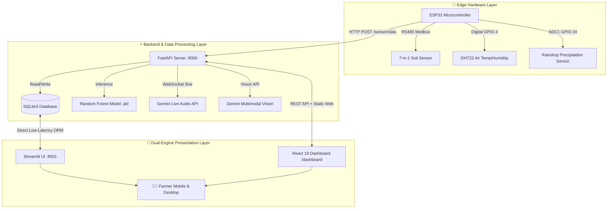

<div align="center">

# 🌱 AgriSense AI
### **Autonomous Precision Agriculture, IoT Soil Intelligence & Multilingual Voice AI Platform**

[](https://python.org)
[](https://fastapi.tiangolo.com)
[](https://streamlit.io)
[](https://react.dev)
[](https://espressif.com)
[](https://deepmind.google/technologies/gemini/)
[](LICENSE)

<p align="center">
  <b>Bridging Artificial Intelligence, IoT Edge Sensing, and Local Vernacular Languages for Modern Sustainable Farming.</b>
</p>

[Key Features](#-key-features) • [System Architecture](#-system-architecture) • [Hardware & ESP32](#-hardware--iot-sensor-node) • [Dual-Engine UI](#-dual-engine-frontend) • [API Reference](#-api-endpoints) • [Quickstart](#-quickstart--installation) • [Deployment](#-deployment)

---

</div>

## 📌 Executive Summary

**AgriSense AI** is a full-stack, enterprise-grade precision agriculture ecosystem built to empower farmers with actionable, real-time agronomic intelligence. 

By unifying **IoT soil telemetry** (7-in-1 Modbus RS485 probes), **Random Forest Machine Learning**, **Google Gemini Multimodal Vision**, and **low-latency Gemini Live WebSockets**, AgriSense AI delivers real-time crop selection, moisture-driven irrigation scheduling, 4-stage split fertilizer dosage planning, leaf disease diagnosis, and voice-assisted advisory across **6 Indian languages** (*Telugu, Hindi, Tamil, Kannada, Marathi, and English*).

---

## 🚀 Key Features

```
                                  ┌────────────────────────┐
                                  │   🌱 AgriSense Core   │
                                  └───────────┬────────────┘
         ┌──────────────────┬─────────────────┼──────────────────┬──────────────────┐
         ▼                  ▼                 ▼                  ▼                  ▼
┌────────────────┐ ┌────────────────┐ ┌────────────────┐ ┌────────────────┐ ┌────────────────┐
│  🌾 Crop AI    │ │  📡 IoT Node   │ │ 💧 Irrigation  │ │ 🌿 Fertilizer  │ │ 🦠 Leaf Doctor │
│  Random Forest │ │  ESP32 7-in-1  │ │  Moisture      │ │  NPK Deficit   │ │  Gemini Vision │
│  22 Crops ML   │ │  Modbus RS485  │ │  Pump Timer    │ │  4-Stage Split │ │  Pathology AI  │
└────────────────┘ └────────────────┘ └────────────────┘ └────────────────┘ └────────────────┘
```

### 1. 🌾 Machine Learning Crop Recommendation
* **Algorithm**: Optimized `RandomForestClassifier` trained on 2,200 curated agro-climatic records with 99.3% validation accuracy.
* **Input Vector**: Nitrogen ($N$), Phosphorus ($P$), Potassium ($K$), Soil pH, Ambient Temperature, Air Humidity, and Rainfall.
* **Multi-Crop Probabilities**: Outputs top-ranked crop choices with probability confidence meters and crop agronomy cards.

### 2. 📡 Real-Time IoT Soil & Climate Telemetry
* **Hardware Integration**: Custom ESP32 firmware interfaced via **MAX485 TTL-to-RS485 transceiver** to query industrial 7-in-1 soil probes (Moisture, Temp, EC, pH, N, P, K).
* **Dual-Baud Auto-Probing**: Dynamically negotiates Modbus RTU at 4800 or 9600 baud with hardware CRC-16 validation.
* **Ambient Sensing**: Integrated DHT22 sensor and analog raindrop precipitation sensor.

### 3. 💧 Smart Irrigation Advisor & Audio Guidance
* **Moisture-Driven Verdict**: Classifies field condition into *Urgent Watering*, *Plan Watering (24-48h)*, *Optimal Moisture*, or *Waterlogged*.
* **Critical Growth Stage Timelines**: Detailed Days-After-Sowing (DAS) schedules for Rice, Maize, Cotton, Chickpea, Banana, and Watermelon.
* **Volume & Pump Run-Time Calculator**: Calculates exact liters required based on acreage and pump capacity (3 HP, 5 HP, 7.5 HP, or Drip line).
* **🔊 Native Multilingual Audio Briefing**: 20-second spoken summary in 6 regional languages via Web Speech API.

### 4. 🌿 Precision Fertilizer & Nutrient Balance Engine
* **NPK Deficit Analysis**: Compares current soil fertility against crop benchmark standards to calculate deficits.
* **Acreage Bag Calculator**: Converts chemical requirements into commercial bag metrics (*e.g., Urea 45kg bags, DAP 50kg bags, MOP 50kg bags*).
* **4-Stage Split-Dose Plan**:
  * **Stage 1 (Basal)**: Full DAP + Full Potash + 1/3 Nitrogen + Zinc Sulphate.
  * **Stage 2 (Vegetative - 25-35 DAS)**: 1st Urea top-dress.
  * **Stage 3 (Flowering - 50-60 DAS)**: 2nd Urea top-dress + 19:19:19 / Boron foliar misting.
  * **Stage 4 (Grain Filling - 75-90 DAS)**: 0:0:50 Sulphate of Potash foliar spray.
* **Organic Remediation**: Guidelines for Vermicompost, FYM, Neem Cake nitrification inhibitors, and soil pH lime/gypsum balancing.

### 5. 🦠 Multimodal Plant Disease Detection (Doctor AI)
* **Vision Model**: Powered by Google GenAI (`gemini-2.5-flash` / `gemini-3.0`).
* **Instant Assessment**: Farmers upload or snap leaf photos to receive instant disease identification, symptoms diagnosis, organic remedies, and chemical fungicide/bactericide prescriptions.

### 6. 🎙️ Gemini Live Multilingual Voice Assistant
* **Conversational AI**: WebSockets streaming interface connecting directly to Gemini Live Audio for hands-free farmer voice interaction.
* **Complete Vernacular Support**: English, తెలుగు (Telugu), हिंदी (Hindi), தமிழ் (Tamil), ಕನ್ನಡ (Kannada), and मराठी (Marathi).

---

## 🏛️ System Architecture



---

## 🔌 Hardware & IoT Sensor Node

The ESP32 firmware is located in [`esp32/agrisense_esp32.ino`](file:///c:/Users/praveenreddy/OneDrive/Desktop/SmartCropRecommendation%201/esp32/agrisense_esp32.ino).

### Pin Configuration Table

| Sensor / Module | ESP32 GPIO | Interface Type | Electrical Logic | Description |
| :--- | :--- | :--- | :--- | :--- |
| **MAX485 (RO / RX)** | `GPIO 16` | Hardware Serial2 RX | 3.3V / 5V | Receives RS485 Modbus bytes |
| **MAX485 (DI / TX)** | `GPIO 17` | Hardware Serial2 TX | 3.3V / 5V | Transmits Modbus queries |
| **MAX485 (DE / RE)** | `GPIO 5` | Digital Output | 3.3V Logic | Controls Transmit/Receive direction |
| **DHT22 Data** | `GPIO 4` | Digital 1-Wire | 3.3V Logic | Ambient temperature & relative humidity |
| **Raindrop Sensor (AO)** | `GPIO 34` | ADC1 (Input Only) | 0 - 3.3V Analog | Precipitation intensity detection |
| **7-in-1 Sensor VCC** | External Power | DC Power | 9V - 24V DC | Common ground tied to ESP32 GND |

---

## ⚛️ Dual-Engine Frontend

AgriSense AI supports two distinct, production-ready frontend interfaces:

| Interface | Technology | Best Used For | Port / URL |
| :--- | :--- | :--- | :--- |
| **🐍 Python Streamlit App** | Streamlit + Custom CSS + Web Speech API | Rapid deployment, local offline mode, academic presentation | `http://localhost:8501` |
| **⚛️ React 18 Single-Page App** | React 18 + Tailwind CSS + Babel CDN + REST | Cloud microservices, mobile-first Web App, direct API consumption | `http://localhost:8000/dashboard` |

---

## 📡 API Endpoints

The FastAPI backend exposes the following REST & WebSocket endpoints:

| Method | Endpoint | Description | Payload / Response |
| :--- | :--- | :--- | :--- |
| `GET` | `/` or `/dashboard` | Serves the interactive React 18 SPA | `text/html` |
| `GET` | `/health` | Server health check & status | `{"status": "healthy"}` |
| `POST` | `/sensor/data` | Ingests ESP32 or manual farm telemetry | JSON with NPK, pH, Temp, Moisture |
| `GET` | `/farm/latest/{farmer_id}` | Retrieves the latest farm reading | JSON object with latest readings |
| `POST` | `/predict/crop` | Executes Random Forest ML crop prediction | `{"recommended_crop": "rice"}` |
| `GET` | `/docs` | Swagger OpenAPI interactive documentation | `text/html` |
| `WS` | `/live` | Bidirectional Gemini Live WebSocket stream | Audio PCM / JSON stream |

---

## 💻 Quickstart & Installation

### 1. Prerequisites
* Python `3.10` or higher
* Git
* (Optional) Arduino IDE for flashing ESP32

### 2. Clone & Setup Virtual Environment
```bash
# Clone the repository
git clone https://github.com/PraveenReddy171/AgriSense-AI.git
cd AgriSense-AI

# Create virtual environment
python -m venv .venv

# Activate virtual environment
# Windows:
.venv\Scripts\activate
# Linux / macOS:
source .venv/bin/activate
```

### 3. Install Dependencies
```bash
pip install -r requirements.txt
```

### 4. Environment Configuration
Create a `.env` file in the root directory (or copy from `.env.example`):
```env
GEMINI_API_KEY=your_google_gemini_api_key_here
GEMINI_VISION_MODEL=gemini-2.5-flash
```

### 5. Launch the Application (Production React Mobile App + FastAPI)

```bash
# Start FastAPI Server serving the compiled React Mobile App:
python server.py
# or
uvicorn server:app --host 0.0.0.0 --port 8000 --reload
```
👉 Open **[http://localhost:8000](http://localhost:8000)** in your browser or smartphone.

To develop the React frontend with hot-module reload:
```bash
cd frontend
npm install
npm run dev
```
👉 Open **[http://localhost:5173](http://localhost:5173)** in your browser.

---

## ☁️ Deployment

### 1. Render Deployment (Production Mobile Web App)
The project runs as a high-performance **FastAPI + React 18 Mobile App** with Live Voice AI on Render (no Streamlit required):
1. Push your repository to GitHub.
2. In the [Render Dashboard](https://dashboard.render.com):
   - **If deploying via Blueprint**: Click **New +** $\rightarrow$ **Blueprint** and select this repo (uses [`render.yaml`](file:///c:/Users/praveenreddy/OneDrive/Desktop/SmartCropRecommendation%201/render.yaml)).
   - **If deploying as a Web Service**:
     - **Environment**: `Python 3`
     - **Build Command**: `pip install -r requirements.txt`
     - **Start Command**: `uvicorn server:app --host 0.0.0.0 --port $PORT` (also automatically read from [`Procfile`](file:///c:/Users/praveenreddy/OneDrive/Desktop/SmartCropRecommendation%201/Procfile))
3. Add your `GEMINI_API_KEY` under Environment Variables.
4. Render serves the unified React Mobile App at `/` and `/dashboard` with full multilingual voice, farm intelligence, and daily 1-minute audio briefings.

### 2. Self-Hosted Linux / Cloud VM (systemd / Background Daemon)
To deploy on your own private server (AWS EC2, DigitalOcean, Ubuntu VM, or on-premise):
```bash
# Run FastAPI Backend with React SPA as background service
nohup python server.py > server.log 2>&1 &
```

---

## 📂 Repository Directory Structure

```
AgriSense-AI/
├── app.py                      # Production entrypoint (boots FastAPI + React Mobile App)
├── server.py                   # FastAPI REST API + WebSocket server
├── fertilizer.py               # Crop agronomy & fertilization knowledge base
├── train_model.py              # Random Forest training & evaluation script
├── render.yaml                 # Private Cloud deployment blueprint
├── requirements.txt            # Production Python dependencies
├── README.md                   # Comprehensive platform documentation
│
├── static/                     # Web client assets
│   └── react_dashboard.html    # Standalone React 18 Single-Page Application
│
├── modules/                    # Application feature engines
│   ├── login.py                # Farmer authentication & language management
│   ├── farmer_home.py          # Dashboard home with audio briefing
│   ├── farm_data.py            # High-speed SQLite farm data engine
│   ├── crop_recommendation.py  # ML crop recommendation & probability ranking
│   ├── crop_details.py         # 22-Crop agronomic reference database
│   ├── soil_health.py          # Soil nutrient health scoring & NPK metrics
│   ├── fertilizer_advisor.py   # 4-stage split dose advisor & bag calculator
│   ├── irrigation_advisor.py   # Smart moisture-based irrigation advisor
│   ├── disease_detection.py    # Gemini Multimodal Vision leaf doctor
│   ├── ai_assistant_page.py    # Real-time voice & text chat assistant
│   ├── ai_engine.py            # Gemini API streaming integration
│   ├── live_voice_page.py      # Dual-mode Gemini Live voice calling
│   ├── live_context.py         # Dynamic DB context extractor
│   └── prediction_history.py   # Historical prediction logs & metrics
│
├── database/                   # Local database engine
│   ├── database.py             # SQLite schema initializer
│   └── farmers.py              # Farmer CRUD operations
│
├── dataset/                    # Data sources
│   └── Crop_recommendation.csv # 2,200 agricultural dataset records
│
├── models/                     # Trained ML artifacts
│   └── crop_model.pkl          # Serialized Random Forest model
│
└── esp32/                      # Microcontroller firmware
    └── agrisense_esp32.ino     # Complete 7-in-1 Modbus RS485 + DHT22 firmware
```

---

## 📜 License

This project is licensed under the **MIT License** — feel free to use, modify, and distribute for agricultural research and development.

---

<div align="center">
  <sub>Built with ❤️ for Indian Farmers • Empowering Agriculture through AI & IoT</sub>
</div>
